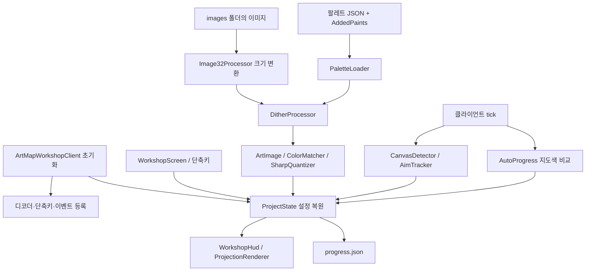

# ArtMap Workshop JAR 구조 분석

분석 대상: `artmap-workshop-fabric-1.9.20-alpha-items.1.jar`

- SHA-256: `202268b1ffacdd85c849171929fd1fc97eb82bba082e9040630e83097af8f4c5`
- 원본 크기: 637,003 bytes. ZIP CRC 검사 통과.
- Minecraft 1.21.4, Fabric Loader >=0.16.10, Java >=21, Fabric API가 필요한 클라이언트 모드.
- 최상위 패키지: `com.easttg.artmapworkshop`.
- 자체 클래스 파일 40개 → 내부 클래스 등을 포함하는 Java 파일 32개, CFR 출력 기준 4,358줄.
- 포함된 외부 JAR 6개: TwelveMonkeys 3.13.1의 common-image, common-io, common-lang, imageio-core, imageio-metadata, imageio-webp.
- 원본 Java 소스, Gradle 프로젝트, 테스트는 첨부물에 없음.

## 분석 방법과 한계

Maven Central에서 CFR 0.152를 받아 같은 배포처의 SHA-512와 일치함을 확인한 뒤 정적 디컴파일했다. 대상 모드를 실행하지 않았으며 원본 JAR와 `/workspace/etc` 저장소는 수정하지 않았다.

`src/main/java/`는 분석용 복원 결과이고 빌드 가능한 원본 소스가 아니다. Minecraft 참조는 `class_310`, `method_*`, `field_*` 같은 Fabric intermediary 이름으로 남아 있다. Minecraft/Fabric 외부 의존성을 제공하지 않아 CFR의 외부 클래스 미확인 주석이 있고, 일부 try/finally 복원 경고가 있다. 따라서 실제 게임 동작, 원본과의 완전한 동등성, 재컴파일 성공은 검증하지 않았다.

## 기능별 구조

| 영역 | 주요 클래스 | 역할 |
|---|---|---|
| 진입점 | ArtMapWorkshopClient | 디코더와 단축키 등록, 클라이언트 tick·렌더·종료 이벤트 연결 |
| 중앙 상태 | ProjectState | 이미지 선택/로드, 설정, 타일·좌표, 색상 집중, 완료 상태, JSON 저장/복원 |
| 이미지 입력/크기 | ImageDecoders, Image32Processor, ImageStyle | PNG/JPEG/WebP, 32 배수 크기 조정, 미리보기, 최근접/바이큐빅 보간 |
| 작업 데이터 | ArtImage, ArtImage.Cell | 이미지를 32×32 작업 타일로 나누고 픽셀별 PaletteColor와 alpha 보관 |
| 색상 변환 | ColorMatcher, ColorMath, SourceColorMath, SharpQuantizer, DitherProcessor | Lab 기반 색상 거리, 톤 보정, 로고 색상 군집화, 디더링 |
| 팔레트 | PaletteLoader, PaletteColor, PaletteMode, AddedPaints | JSON 팔레트 읽기와 코드 내 추가 물감 결합 |
| 게임 색상/아이템 | MeasuredMapColors, PaintItems, MapColorLogger | 물감 코드→지도 색상 ID·아이템, 깃털/석탄 단계 표시, 색상 ID 기록 |
| 캔버스/조준 | CanvasDetector, AimTracker, ProjectionState | 액자 선택, 시선과 캔버스 평면의 교점, 32×32 좌표 계산 |
| 진행 자동 감지 | AutoProgress | 지도 색상 변경을 감시하고 목표색과 비교해 완료 상태 갱신 |
| 화면 | WorkshopScreen, WorkshopHud, WorkshopTab, ProjectionRenderer | 설정 화면, HUD, 3D 격자·픽셀·완성 이미지 미리보기 |
| 옵션 | WorkMode, AccessibilityMode, PixelMarkerMode, Resize32Mode, DitherMode, ColorMatchMode | 작업·접근성·마커·변환 옵션 |

## 실행 흐름



초기화 시 12개 단축키를 등록하고 `END_CLIENT_TICK`에서 조준 추적, 자동 진행 감지, 키 처리, 지연 저장을 수행한다. `AFTER_ENTITIES`에서 월드 오버레이를 그린다. 종료·서버 연결 해제 때 보류 중인 진행 상태를 저장한다.

입력 이미지는 크기 변환 후 PNG로 저장되고, 선택 팔레트와 디더링을 적용해 `ArtImage`로 바뀐다. 실제 캔버스 단위는 **32×32**다. `makeSelectedImage128Multiple`이라는 메서드 이름이 남아 있지만 현재 구현은 32 배수 크기를 사용한다.

## 색상과 아이템

- `palette.json`: 물감 항목 50개, 로더 조건을 통과하는 RGB 변형 190개.
- `dose_palette.json`: 물감 항목 49개, RGB 변형 196개.
- `AddedPaints`: N001~N011의 11개 물감, 각각 기본/깃털 1회/석탄 1회/석탄 2회의 네 단계, 총 44개 변형을 추가한다.
- 따라서 로더 결과는 각각 234개 또는 240개 변형이다. 흑백 모드를 선택하면 `ArtImage`가 일부 코드만 다시 추린다.
- `ColorMatcher`: 기본 Lab 거리, SOFT_TONE, ADAPTIVE_TONE_V2.
- `DitherProcessor`: OFF, Floyd–Steinberg, Bayer 4×4, Bayer 8×8.
- `ImageStyle`: LOGO는 최근접 보간, ILLUSTRATION은 바이큐빅 보간. LOGO이며 디더링 OFF일 때 색상 군집화 경로를 사용한다.
- 물감 RGB, 아이템, 실제 지도색 ID는 서로 다른 위치에 정의된다. 물감 추가·교체 시 JSON만 변경하면 아이콘 표시 또는 자동 완료 판정이 어긋날 수 있어 `AddedPaints`, `PaintItems`, `MeasuredMapColors`까지 함께 확인해야 한다.

## 자동 진행 판정

`AutoProgress`는 Minecraft 지도 데이터 128×128을 읽는다. 작업 픽셀 하나는 지도 픽셀 4×4에 대응한다. 해당 16개 픽셀이 모두 같은 색상 ID이고 목표 색상 ID와 일치하면 완료로 판정한다.

이전 지도 바이트와 달라진 작업 셀만 BitSet에 넣는다. 대기 셀의 판정 루프는 tick당 최대 128개 또는 약 2ms로 제한된다. 이 제한은 앞선 16,384개 바이트 비교 전체를 포함하지 않는다. 지도·이미지·타일·월드·액자가 바뀌면 기준 상태를 다시 잡는다. 최초 샘플은 기준색 저장만 하므로 기존 그림 전체를 즉시 판정하는 경로와는 다르다.

분석한 이 기능은 지도색 변화에 따른 완료 추적이다. 자동으로 붓질이나 클릭을 수행하는 구현으로 해석해서는 안 된다.

## UI 및 저장 데이터

`WorkshopScreen`은 620×390 기준 패널로 이미지 준비, 색감 선택, 그림 작업, 보기 편하게, 화면 설정, 사용법의 6개 탭을 구성한다.

언어 JSON은 한국어·영어 각각 13개 키로 단축키 관련 번역을 담는다. 화면과 상태 메시지에는 Java에 직접 들어간 한국어 문자열도 많다. 따라서 전체 문구 변경은 언어 JSON 편집만으로 끝나지 않는다.

게임 설정 디렉터리 기준:

```text
config/artmap_workshop/
  images/             입력 PNG/JPG/JPEG/WebP
  processed/          크기·스타일 변환 PNG
  progress.json       UI 설정과 작업별 완료 상태
  color-id-log.jsonl  사용자가 실행한 지도색 기록
```

진행 상태는 타일/픽셀별 BitSet을 바탕으로 저장된다. 이미지 내용 CRC와 스타일·팔레트·색상 매칭·디더링·흑백 옵션으로 작업 ID를 만들어 `workspaces` 아래에 진행을 분리한다. 일부 진행 변경은 약 1초 뒤 저장하며 종료 시 flush한다. 저장은 임시 파일에 쓴 뒤 atomic move를 시도하고 미지원 시 일반 교체로 대체한다.

## 수정 전 알아둘 구조적 특성

1. `ProjectState`는 디컴파일 기준 1,118줄이며 전역 static 상태에 많은 기능이 의존한다. 이미지 처리나 저장 방식 수정은 UI와 진행 복원에도 영향을 줄 수 있다.
2. 화면 표시 3종(설정 화면, HUD, 월드 오버레이)이 별개다. UI 변경 범위를 먼저 구분하는 것이 좋다.
3. 이미지 읽기·변환이 키/화면 콜백에서 동기적으로 수행되는 경로가 있다. 큰 이미지의 응답 지연은 실측이 필요한 점검 항목이다.
4. `AutoProgress`의 예외를 조용히 무시하는 경로가 있어 자동 판정 문제를 진단하려면 추가 관측이 필요할 수 있다. 현재 실패를 재현한 것은 아니다.
5. 자체 패키지의 정적 검색에서는 HTTP/소켓 클라이언트 사용을 찾지 못했다. 폴더 열기에 OS 파일 관리자 프로세스를 사용한다. 이는 전체 보안 감사 결과는 아니다.
6. 재빌드에는 Java 21 JDK, Minecraft/Fabric 의존성, 대응 매핑, 빌드 설정 복원이 필요하다. 현재는 Java 21 실행 환경과 디컴파일 도구만 확인했고 `javac`, `javap`, `gradle`, `mvn`은 PATH에서 찾지 못했다.

## Claude 공동 작업 가능 여부

현재 직접 호출 가능한 상태는 아니다.

| 확인 항목 | 결과 |
|---|---|
| 이 대화의 Claude/Anthropic 커넥터 | 제공된 도구 목록에 없음 |
| 팀 에이전트의 Claude 모델 선택 | 현재 허용 모델 목록에 없음 |
| `claude` 실행 파일 | PATH에서 찾지 못함 |
| 전역 npm 패키지 | 설치 항목 없음 |
| 일반 Claude 설정 위치 | `~/.claude`, `~/.claude.json`, `~/.config/claude` 없음 |
| 관련 환경 변수 | CLAUDE/ANTHROPIC/BEDROCK/VERTEX/API_KEY가 포함된 이름 없음 |
| 클라우드 설정 메타데이터 | secret/runtime variable/outbound identity 등록 없음 |
| 인증 없는 `GET https://api.anthropic.com/v1/models` | 프록시 CONNECT 단계에서 HTTP 403, API까지 도달하지 못함 |

인증 값은 읽거나 출력하지 않았고 JAR나 복원 코드를 Claude에 전송하지 않았다. 인증 없는 연결 확인은 Claude 계정 접근성이나 모델 실행 검증이 아니다. 위 403은 네트워크 프록시 응답이며 자동 승인 심사의 거절이 아니다.

직접 협업하려면 별도 Claude CLI 또는 API 클라이언트, 선택한 방식의 유효한 인증, 필요한 도메인의 네트워크 허용이 필요하다. 직접 Anthropic API를 사용하는 방식에서는 최소 `api.anthropic.com` 허용이 필요하며, CLI 로그인 방식의 추가 목적지는 선택한 공식 설치·인증 절차에서 확인해야 한다. 인증 정보는 채팅 대신 환경 설정의 보안 입력 경로를 사용해야 한다.

이번 요청은 가능 여부 확인이므로 Claude 설치·인증·네트워크 설정 변경이나 설정 초안 저장은 수행하지 않았다. 현재도 이 문서와 복원 코드를 별도 Claude 세션에 사용자가 전달하고 피드백을 가져오는 수동 협업은 가능하다. 공유 파일의 동시 자동 편집은 현재 지원이 확인되지 않았다.

## 저장소 내 작업 위치

이 분석 결과는 `/workspace/etc/마크 그림 도우미`에 정리했다.

- `../original/`: 변경하지 않고 보관하는 원본 JAR.
- `../src/main/java/com/easttg/artmapworkshop/`: 분석용 복원 Java 파일 32개. 이후 코드 수정 위치.
- `../src/main/resources/`: 원본 JSON 및 pack.mcmeta. 이후 리소스 수정 위치.
- `original-MANIFEST.MF`: 원본의 빌드 메타데이터 기록. 새 빌드에 그대로 적용하지 않는다.

위 경로는 이 문서가 있는 `docs` 디렉터리 기준이다. 빌드 설정과 의존성은 아직 복원하지 않았고 게임 실행도 검증하지 않았다. 디컴파일 도구와 네트워크 진단 임시 파일은 저장소에 넣지 않았다.
